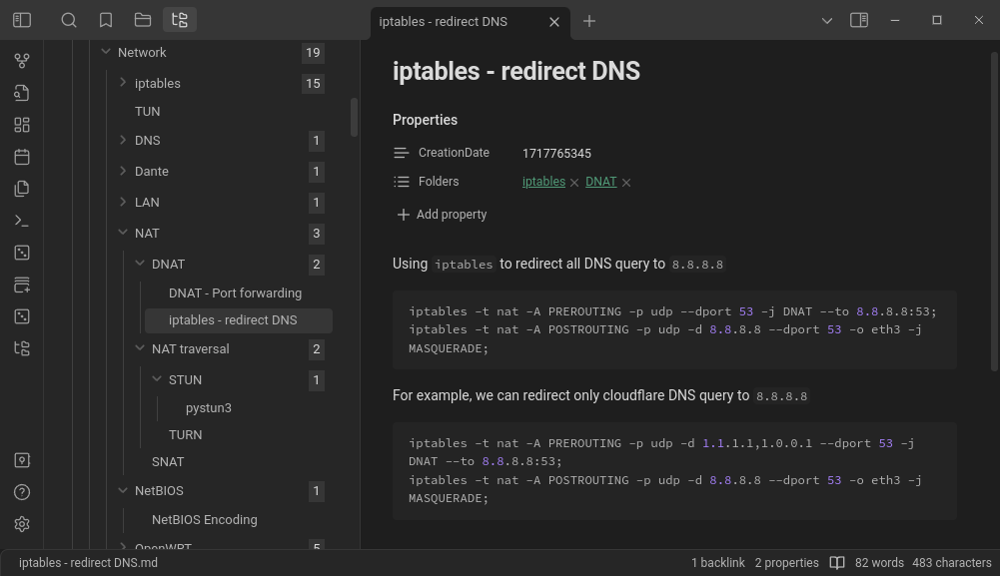

# VirtFolder plugin
A plugin for creating a hierarchical structure in Obsidian.

Allows you to quickly find notes by navigating the knowledge base like a book table of contents.

## Articles

- [How to organize a knowledge base in Obsidian using the Luhmann method](https://medium.com/@mr.grogrig/how-to-organize-a-knowledge-base-in-obsidian-using-the-luhmann-method-e6768c29b18f) (en)
- [VirtFolder — Obsidian plugin overview](https://habr.com/ru/articles/1000502/) (en)
- [VirtFolder — обзор плагина для Obsidian](https://habr.com/ru/articles/1000254/) (ru)

## Features

- The ability to perform all operations using hot keys
- Dragging and dropping notes with the mouse, including custom sort order
- Creating and deleting notes via the right-click menu
- Add files to virtual folders from the file explorer context menu
- Emoji icon picker with categorized groups for notes
- Tag-based note highlighting with configurable colors
- Frontmatter as HTML data attributes for CSS styling
- Optional string format for single-parent folder links
- Create notes via Unique note creator
- Front Matter Title plugin support
- Database optimization
- Tree search using Obsidian's core search syntax

## Searching the tree

Type in the search box above the tree to filter notes. Queries use
Obsidian's search engine, including content, `file:`, `path:`, `tag:`, properties,
quoted phrases, regular expressions, `OR`, and exclusions such as `-term`.
Results update as notes change. Existing path/tag filters still apply.

Only matching notes are shown. Matching children whose parents do not match are
shown at the root of the results; matching orphan notes are also searchable.
Clear the query or press Escape to restore the normal tree and its expanded
branches. Search is local to each VirtFolder pane and resets when the pane closes.
Drag-and-drop is disabled while filtering, since some parents may be hidden.

The core query parser is an internal Obsidian API. If an Obsidian version does
not expose it, the search box displays an error; clearing search still
restores the normal tree.

## Documentation

The current documentation is available in the [docs](./docs/index.md) folder.

The old documentation is located on [GitBook](https://virtfolder.gitbook.io/index).

## Example

https://github.com/user-attachments/assets/a4990b31-c8ea-48c8-815a-98521d81fc7d
